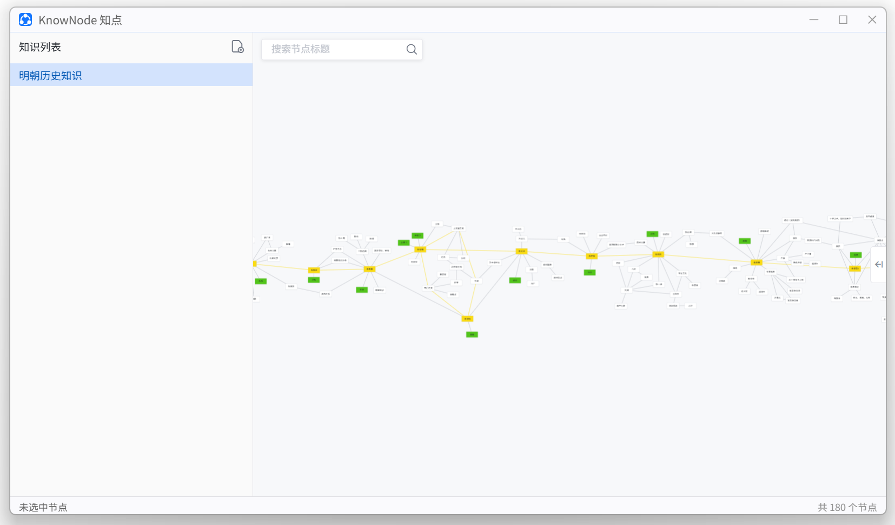

# KnowNode 知点

节点化个人知识管理工具。

人脑是通过节点与关系组织知识的。KnowNode 也以这种方式管理知识。

  

## 特性

- 仅一个exe文件，零依赖
- 体积很小：1.9MB
- 所有内容保存在本机 `%APPDATA%\KnowNode\db.db`，不依赖网络。
- 纯原生，无浏览器依赖，资源消耗极低

## 限制

- 最低支持 Windows 10 1703（build 15063），x64

## 赞助

<table>
  <tr>
    <td align="center">
      
      
支付宝赞助

    </td>
    <td align="center">
      
      
微信赞助

    </td>
    <td align="center">
      
      
作者微信

    </td>
    <td align="center">
      
      
公众号：桌面软件

    </td>
  </tr>
</table>
